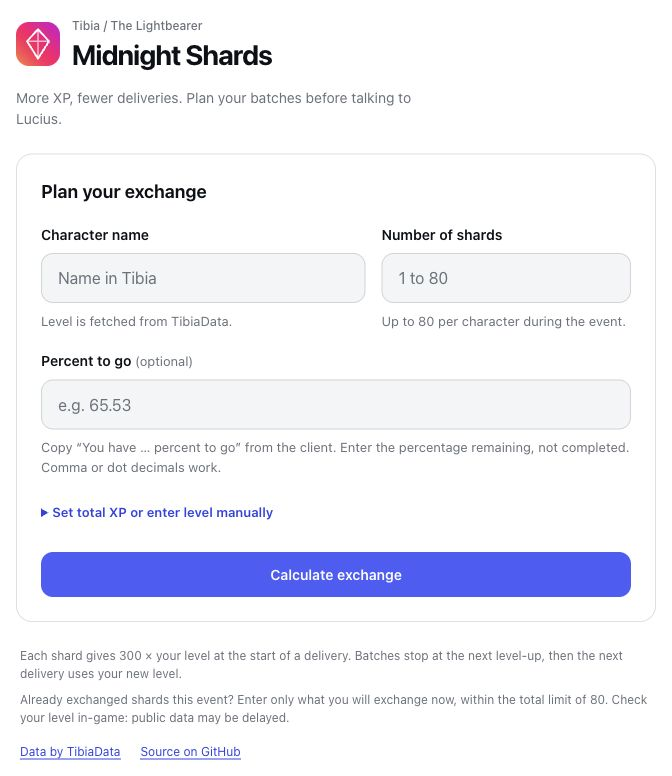

# Midnight Shard Calculator

Plan level-aware Midnight Shard exchanges for Tibia's Lightbearer event.
Compare the XP from one delivery with the **combined XP from every batch**,
then follow the delivery sequence that makes the most of your level-ups.

[Open the calculator](https://nesleykent.github.io/midnight-shard-calculator/) |
[Report an issue](https://github.com/nesleykent/midnight-shard-calculator/issues) |
[Contribute](CONTRIBUTING.md)

[](https://github.com/nesleykent/midnight-shard-calculator/actions/workflows/ci.yml)



## How to use

1. Enter your **character name** and **number of shards**. TibiaData fetches the level.
2. Optionally enter **Percent to go**, copied from the client's “You have … percent
   to go” tooltip. It means percentage remaining, not completed. Both `65.53` and
   `65,53` work.
3. Select **Calculate exchange** to compare the totals and inspect the batches.

For an exact plan, enter your **current total XP** under the optional settings.
Filling XP clears the percentage and vice versa. A manual level option is
available when you prefer not to use the API.

## Read the comparison

| Result | Meaning |
| --- | --- |
| **All at once** | All shards exchanged at the starting level. |
| **In batches (total)** | The sum of XP from every delivery in the batch plan. |
| **Extra XP from batching** | Batch total minus the all-at-once total. |

Every sequence includes a **Total** row for shards and XP, plus a first-batch
recommendation and final level. If no delivery crosses a level boundary,
exchanging everything at once earns the same XP.

## Calculation and precision

Each shard grants `300 × level` at the start of a delivery. Batches stop at the
first shard that levels up; the next delivery uses the new level. Overflow XP
is carried into the next batch. This matches individual-shard XP while grouping
shards that pay the same amount. At low levels, some batches still need only
1 shard because a single shard can advance several levels.

Minimum XP at level L: `(50L³ - 300L² + 850L - 600) / 3`.

| Available progress | Calculation |
| --- | --- |
| Level only | Bounds from the start of the level to 1 XP before the next. |
| Percent to go | Narrower bounds allowing 0.01 percentage points on either side for client display precision. |
| Total XP | An exact sequence for the supplied XP. |

The event limit is **80 shards per character**. If some have already been
exchanged, enter only the amount still intended for exchange, within that total
limit. Public data may be delayed: check your level in-game and recalculate if
XP changes before the exchange. Supported levels: 1 to 10,000.

## Run locally

A static site with no production dependencies, package installation or build step.

```sh
python3 -m http.server 8000 --bind 127.0.0.1
```

Open `http://127.0.0.1:8000`. The legacy `midnight-shards.html` URL redirects to
the same calculator. GitHub Pages serves the site from `main`.

## Validation

Node.js 20 or newer is required for tests. CI runs on Node.js 24.

```sh
node --test
node --check app.js
node --check calculator.js
node --check tibiadata.js
git diff --check
```

The test suite checks level thresholds, overflow XP, sums of all batches,
percentage conversion, rounding bounds, invalid input and API failures. Batch
XP is compared with an independent shard-by-shard simulation. CI runs on pushes
to `main` and pull requests. See [the contribution guide](CONTRIBUTING.md) for
browser checks and asset versioning.

## Architecture and data

| File | Responsibility |
| --- | --- |
| `calculator.js` | Pure level, progress and batch calculations. |
| `tibiadata.js` | Public character lookup and response validation. |
| `app.js` | Form state and result rendering. |
| `index.html`, `styles.css` | Accessible, responsive interface. |
| `tests/` | Node.js tests with no third-party test dependencies. |

Character data comes from the [TibiaData API](https://tibiadata.com/), using
`GET /v4/character/{name}` and `character.character.level` as described in its
[API documentation](https://docs.tibiadata.com/). The typed character name is sent
to TibiaData; only the returned name, level, world and vocation are used in
memory. Lookups cancel when fields change and time out after 12 seconds.

The app does not store character data, use analytics or require an account.
The visual system uses white surfaces, cool neutrals, blue actions and a small
coral-to-magenta brand accent. No external fonts are loaded.
